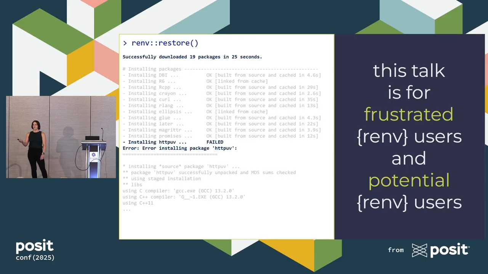

```{r thumbnail, eval=TRUE, echo=FALSE}
#| fig.cap: > 
#|   Screenshot of slide with error message from failed renv restore.
#| fig.alt: >
#|  Left hand side shows console error message  from a failed renv restore;
#|  right hand side shows this talk is for frustrated renv users and potential
#|  renv users.

```

```{r, eval=TRUE, echo=FALSE}
distilltools::icon_link(icon = "fas fa-play-circle",
          text = "recording",
          url = "https://youtu.be/l01u7Ue9pIQ?si=ST6lokQ2j5VVuKrB")

```


```{r, eval=TRUE, echo=FALSE}
distilltools::icon_link(icon = "images",
          text = "slides",
          url = "https://github.com/shannonpileggi/practical-renv/blob/main/practical-renv.pdf")
```

```{r icon-links, eval=TRUE, echo=FALSE}
distilltools::icon_link(icon = "images",
          text = "github repo",
          url = "https://github.com/shannonpileggi/practical-renv")
```

# Abstract


The {renv} package aims to help users create reproducible environments for R projects. In theory, this is great! In practice, restoring a package environment can be a frustrating process due to overlooked R configuration requirements. Join me to better understand the source of environment restoration issues and learn strategies for successful maintenance of {renv}-backed projects.
